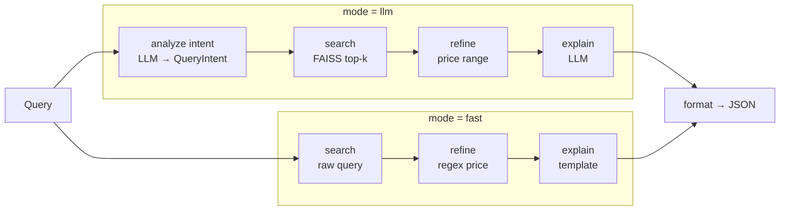

# Product Recommendation Agent

[](https://github.com/alexandranac2/product-recommendation-agent/actions/workflows/tests.yml)

A natural-language product recommender built as a **LangGraph** pipeline over a
**FAISS** vector index, served by **FastAPI**. Ask for *"running shoes under $200"*
or *"food for my puppy"* and get ranked products plus a short explanation.

It ships two interchangeable pipelines behind one endpoint, so the cost/quality
trade-off of using an LLM is explicit rather than hidden:

| Mode | LLM calls | Price parsing | Explanation |
|------|-----------|---------------|-------------|
| `llm` (default) | 2 | structured intent extraction (`gpt-4o-mini`, Pydantic schema) | LLM, grounded in the top results |
| `fast` | 0 | regex (`under $200`, `over 50`, `up to 9.99`) | templated from the result data — cannot hallucinate |

## How it works



- **Indexing** – every product in `data/products.json` becomes one document. Content
  and metadata are generated from whatever fields the product has, so the catalogue
  schema can change without code changes (`rag/ingest.py`).
- **Embeddings** – local `sentence-transformers/multi-qa-MiniLM-L6-cos-v1`; no API
  key needed to build or query the index.
- **Retrieval** – FAISS L2 distance with a `MAX_SIMILARITY_SCORE` cut-off so weak
  matches are dropped instead of padded into the results.
- **Refinement** – semantic search handles relevance; only hard constraints (price)
  are enforced afterwards.
- **Startup** – the index and both graphs are built once in the FastAPI lifespan and
  shared by all requests. The FAISS index is a local build artefact (git-ignored),
  created on first start and reused after.

## Run it

```bash
python -m venv venv && source venv/bin/activate
pip install -r requirements.txt
cp .env.example .env          # add OPENAI_API_KEY (only needed for mode=llm)
python run_api.py             # http://localhost:8000/docs
```

The first start downloads the embedding model and builds the index (~1 min).

```bash
curl -X POST localhost:8000/api/recommendations/ \
  -H 'Content-Type: application/json' \
  -d '{"query": "running shoes under $200", "mode": "fast", "max_results": 3}'
```

```json
{
  "query": "running shoes under $200",
  "recommendations": [
    {"name": "Adidas Ultraboost Running Shoes", "price": 190.0, "category": "Fashion", "score": 0.78, "...": "..."},
    {"name": "Nike Air Max 270", "price": 150.0, "category": "Fashion", "score": 0.80, "...": "..."}
  ],
  "explanation": "Found 2 products matching your search. All products are priced under $200 (average: $170.0). ...",
  "total_results": 2,
  "intent": null
}
```

### Endpoints

| Method | Path | Purpose |
|--------|------|---------|
| `POST` | `/api/recommendations/` | Recommendations (`query`, optional `max_results`, `mode`) |
| `GET` | `/api/recommendations/search?q=&k=&max_score=` | Raw vector search, no LLM |
| `GET` | `/api/health/` · `/api/health/ready` | Liveness · readiness (503 until the index is loaded) |
| `GET` | `/api/routes/` | Route listing |

## Tests

```bash
pip install -r requirements-dev.txt
pytest -q
ruff check . && ruff format --check .
```

The suite runs fully offline: a keyword-overlap stand-in replaces FAISS and the two
LLM calls are stubbed, so CI needs no API key or model download. It covers ingestion,
score filtering, price refinement (LLM and regex paths), the zero-LLM guarantee of
`fast` mode, request validation and error handling.

## Retrieval eval

`evals/queries.json` holds 30 labelled queries that deliberately avoid product
names ("my old dog has stiff joints", "portable charger for my phone"), scored
against the real embedding model and FAISS index:

```bash
python -m evals.retrieval_eval
```

| queries | hit@1 | hit@3 | recall@5 | MRR |
|--------:|------:|------:|---------:|----:|
| 30 | 0.97 | 1.00 | 1.00 | 0.98 |

The one miss: *"powerful laptop for software development"* ranks the budget student
laptop first. With a 30-product catalogue these numbers are a regression guard, not
a benchmark — CI fails if hit@3 drops below 0.9.

## Project layout

```
api/            FastAPI app, lifespan, routes
config/         pydantic-settings (all tunables; override via env/.env)
rag/            ingestion, vector store, intent model, LLM pipeline (agent/ + nodes/)
simple_rag/     zero-LLM pipeline variant
data/           sample catalogue (30 products)
tests/          offline pytest suite
evals/          labelled retrieval eval
```

## Limitations

- Demo catalogue of 30 products; FAISS is rebuilt from scratch when the catalogue
  changes (delete `alexs_vectorstore/`).
- No reranker or hybrid keyword search — pure dense retrieval.
- No auth or rate limiting; intended as a local/demo service.
